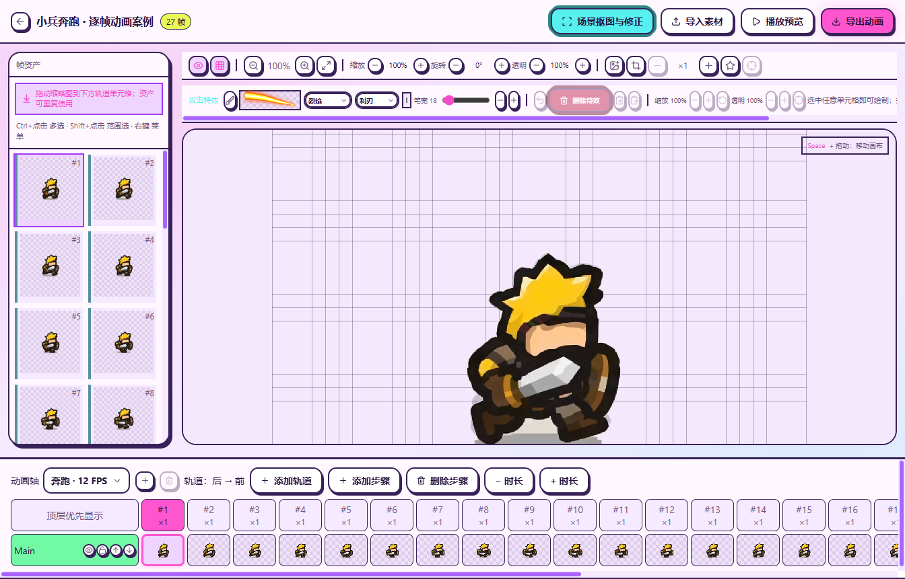
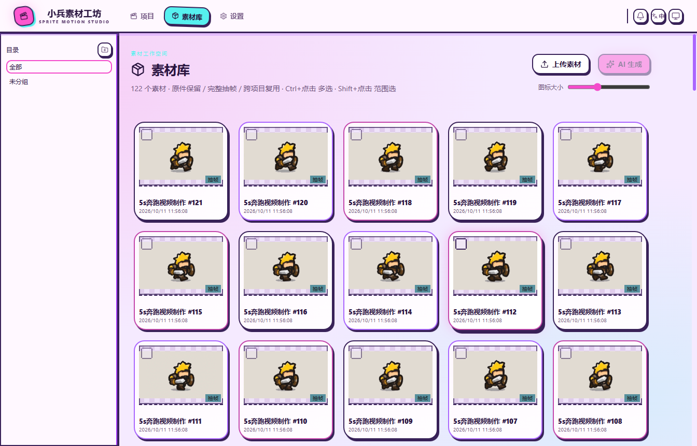
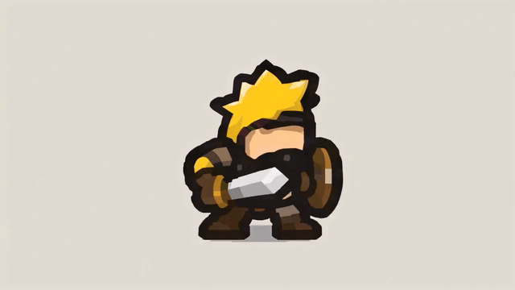
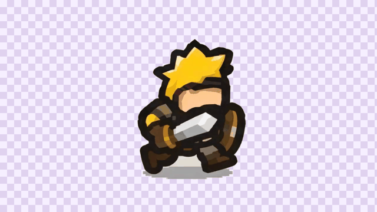
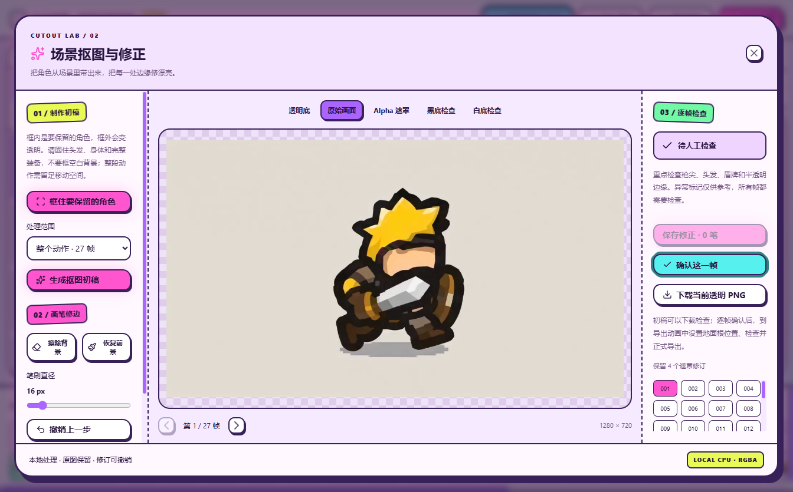
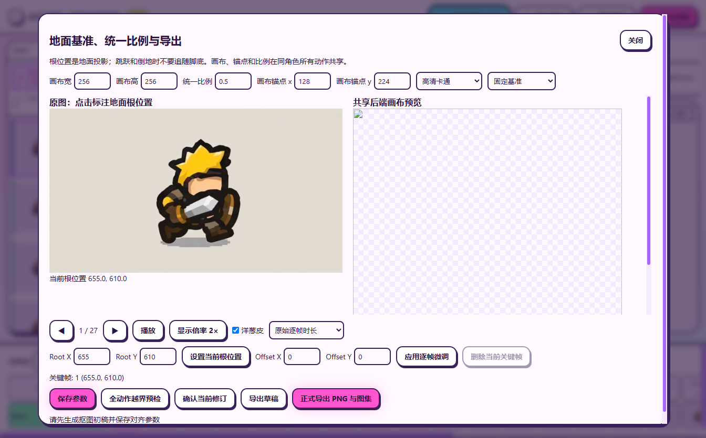

# Sprint Motion Studio · 小兵动画素材工坊

基于 [FrameBaker](https://github.com/taotao7/FrameBaker) 二次开发的 Windows 动画素材工具。现在的界面采用糖果配色与手绘边框，支持视频完整抽帧、抠图修正、地面基准对齐、审核导出，以及共享工作区的 CLI / MCP。

**[下载 Windows 便携安装包](https://github.com/wzh20010805-boop/Sprint-Motion-Studio/releases/latest)** · [使用说明](docs/p3-p5-guide.md) · [开发与验证记录](docs/evidence/p2-p5/report.md) · [二次开发说明](README_SFS.md)

## 当前界面

以下截图由当前 Windows 便携版实际运行拍摄，展示此前导入的「5s奔跑视频制作.mp4」及其逐帧角色素材。

| 动画编辑器 · 抠图后的奔跑角色 | 素材库 · 保留视频与完整原帧 |
| --- | --- |
|  |  |

## 奔跑案例

使用此前导入的原视频展示实际来源，用项目现有帧生成动作预览。原视频保留背景，抠图修正后的角色以棋盘格显示；示例不代表所有帧已经通过人工质量审核。

| 导入的原视频 | 当前项目的抠图帧预览 |
| --- | --- |
|  |  |

| 遮罩修正 | 地面基准与统一画布 |
| --- | --- |
|  |  |

[下载此案例的原视频](docs/media/sfs/source-run.mp4)。展示媒体用于说明本项目工作流程；沿用用户此前提供的素材，不属于项目 MIT 源码许可授权的素材库。

## 可以做什么

- 导入 MP4 / GIF 或 PNG 序列，保留原文件、完整显示帧与源时序。
- 本地 CPU 自动抠图、框选角色，擦除 / 恢复遮罩，撤销并逐帧检查透明边缘。
- 调整公共画布、比例、地面根点及逐帧偏移，通过预览核对动作。
- 经审核导出透明 PNG 序列、规则多页图集、manifest、联系表、背景 MP4 与完整 ZIP；未审核内容可以显式导出草稿。
- GUI、CLI 与九工具 MCP 共用同一工作区、修订号与导出逻辑。

## Windows 安装与启动

1. 从 [Releases](https://github.com/wzh20010805-boop/Sprint-Motion-Studio/releases/latest) 下载 `SpriteMotionStudio-win-x64-1.0.0.zip`。
2. 解压到可写目录，双击 `SpriteMotionStudio.exe` 或 `START.cmd`。这是便携安装包，无需另装 Node.js、Bun 或 Python。
3. 自动抠图需在「素材工坊」菜单离线导入或明确下载 u2netp 模型。模型没有随包附带，其余本地操作可断网运行。
4. 工作区默认存入当前用户 LocalAppData 下的 `SpriteMotionStudio/workspaces/default`，可通过菜单切换到已有工作区。

包内附 SHA256 校验清单、许可、CLI / Codex 接入说明与示例媒体。本版已完成本机 Windows 启动、换目录、受限 PATH、300 帧纹理预算及 GUI / CLI 输出一致性验证；干净 Windows 虚拟机与真实美术质量验收尚未完成。二进制未签名。

## CLI 与 Codex

```powershell
.\sfs.exe doctor --json
.\sfs.exe project list --json
.\sfs.exe --help
.\sfs.exe schemas
.\sfs.exe mcp stdio --workspace "D:\素材工作区"
```

完整参数、审核规则和 recipe 示例见 [P3–P5 使用说明](docs/p3-p5-guide.md)。项目提供 [本地 Skill](skills/soldier-frame-studio/SKILL.md)，不会自动修改全局 Codex 配置。

## 从源码开发

```powershell
git clone https://github.com/wzh20010805-boop/Sprint-Motion-Studio.git
cd Sprint-Motion-Studio
powershell -NoProfile -ExecutionPolicy Bypass -File .\scripts\setup_sfs.ps1 -IncludeDesktop -IncludeValidationPython
.\sfs.cmd doctor --json
.\Start-SFS.cmd
```

源码启动需要 FFmpeg / ffprobe；安装说明见 [README_SFS.md](README_SFS.md)。开发检查：`bun test tests`、`bun run typecheck`、`python -m pytest workers/image/tests`。用户工作区、模型、虚拟环境及构建输出不提交到 Git。

## 来源与许可

保留 [FrameBaker](https://github.com/taotao7/FrameBaker) 的上游历史与 [MIT 许可](LICENSE)。Windows 包中的运行时、FFmpeg、字体和 Python 依赖各自遵循其许可证，详见 [第三方说明](THIRD_PARTY_NOTICES.md) 和 [依赖源码与重建说明](docs/licenses/distribution-sources.md)。上游界面和演示案例已由本项目实拍界面与用户此前提供的奔跑案例替换。

## 最近版本

<!-- latest-changelog:start -->
## Latest Changes

### [1.0.0](docs/CHANGELOG.md#100---2026-10-11) · 2026-10-11

- Run the complete CI suite on Linux and Windows with verified FFmpeg/ffprobe downloads and an explicit Electron installer. Reuse the current Bun for source CLI startup when PATH is isolated; execute native window tests on Windows and retain validation evidence.

- SFS P3–P5: shared character canvas/scale and ground-root keyframes, authoritative Pillow preview/export, exact-revision/file-hash review, immutable PNG/grid/manifest/ZIP packages, resumable jobs and validated caches, offline CLI schemas/recipe plus nine-tool MCP, and a standalone Windows Electron/Bun/Python/FFmpeg portable bundle. Local relocated/runtime/300-frame/GUI-CLI consistency tests pass; clean-VM and real artistic approval remain external acceptance steps.

- Unify desktop project and library imports: retain independent originals, video/GIF, every source frame and exact timing for cross-project reuse. Repeated extraction reuses records; first upgraded startup backfills legacy imports. Align upload controls with available matting/extraction/generation capabilities and use full extraction for video context actions.

- Fix asynchronously loaded onion-skin textures reappearing during playback preview. Editing can still show neighboring poses; exported PNGs render only their own timeline step.

- Fix background-only selections deleting the character: select on the original image, reject empty/weak automatic masks atomically, retain previous versions, and display UTF-8 Windows diagnostics. Nearly uniform backgrounds now use connected color removal to preserve shield interiors and detached thin equipment.

- P2 adds CPU Rembg batch sessions, full-coordinate ROI, immutable automatic/manual masks, erase/restore brushes, persistent undo, alpha/black/white inspection, review jobs and shared CLI endpoints. Missing engines no longer copy originals as success.
- Replace the upstream pixel/cassette theme with saturated candy colors, neon accents, hand-drawn sticker borders and an original vector soldier across light/dark pages.

- Add all-frame / inclusive frame-range preview with start/end inputs, single-frame loops and existing per-step durations. Clamp after deletion and reset on action changes. Preview only; assets and exports are unchanged.

- Explicitly hide Windows background consoles for media probing, extraction, legacy jobs and CLI dependency checks. Add native startup-info and visibility regressions while keeping the editor window visible.

- Fix Windows Start-SFS.cmd launching an invisible GUI process: normal GUI launches no longer use windowsHide, with a real batch-launch visibility regression test.

- Soldier Frame Studio P0 audits pinned upstream history, Windows/Bun/FFmpeg/licenses and Electron feasibility, preserving real failure evidence.
- P1 adds complete display frames, exact PTS/rational timing, immutable sources, consistent migration backups, shared GUI/CLI service and persisted jobs. All frames are default; legacy sampling is explicit.
- The isolated entry binds loopback and verifies API/WS token, Host and Origin; unavailable matting fails explicitly. Cache reuse, concurrent stale-lock recovery and interrupted GUI finalization are repaired.
- Serve the installed Pixi compatibility polyfill under strict CSP. Scene matting and standalone distribution remain future phases.

### [0.5.0](docs/CHANGELOG.md#050---2026-09-02) · 2026-09-02

#### Added

- Added worker-backed color-key matting for image materials with canvas eyedropper sampling, dominant-color palettes, 0–255 Chebyshev tolerance, optional edge softness, live preview, and single or batch application while preserving source images.
- Added optional solid reference backgrounds to all generation dialogs, with high-contrast presets, custom colors, palette-based recommendations, and temporary server-side ImageMagick flattening that never modifies source materials or frames.

#### Removed

- Removed the target-skeleton selector from reference decomposition: it only influenced the generation prompt and grid rows/columns, downstream split, naming, and binding never consumed it, and `targetSkeletonId` was never accepted by the server; the split grid is back to manual rows/columns plus the humanoid default.

[View the complete changelog →](docs/CHANGELOG.md)
<!-- latest-changelog:end -->
