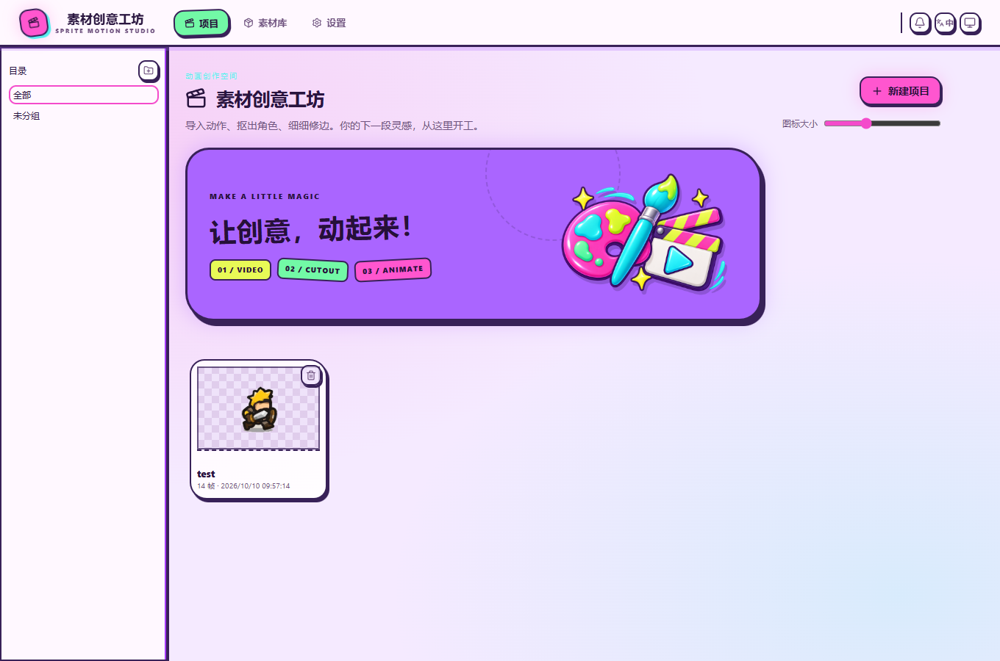
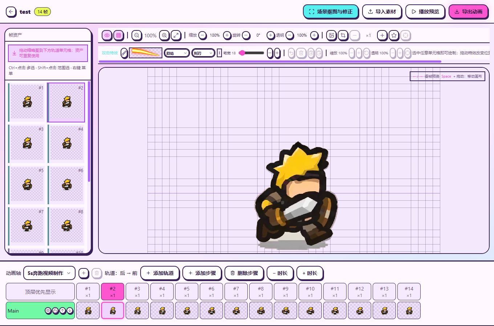
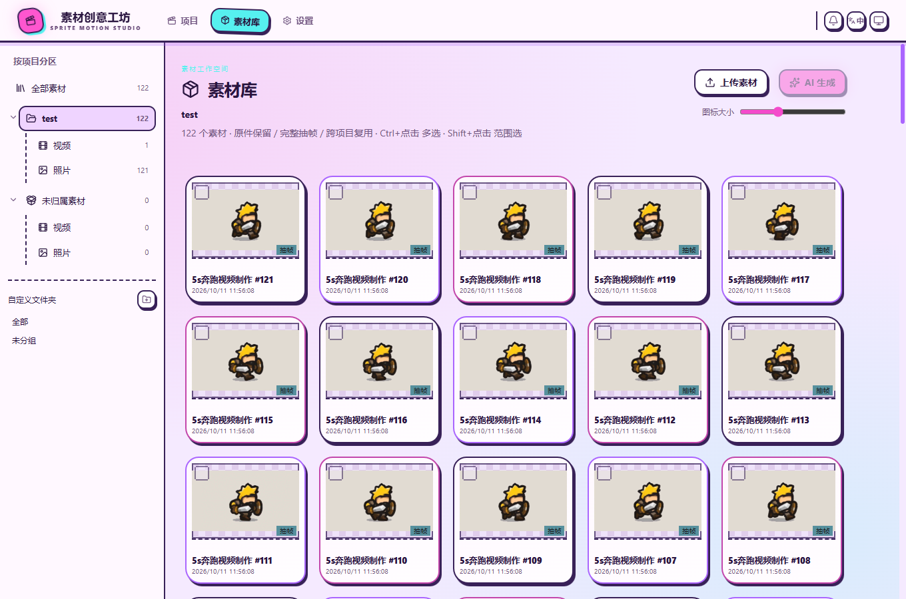
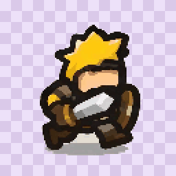
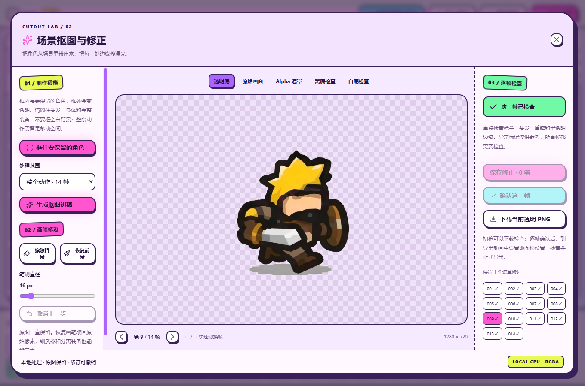
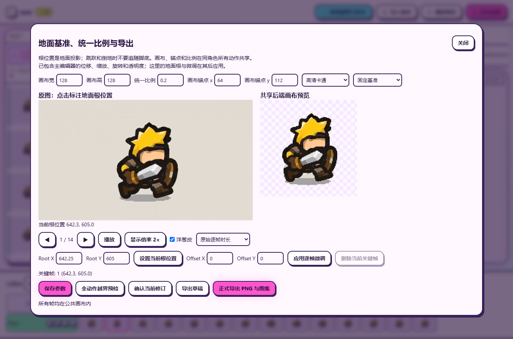
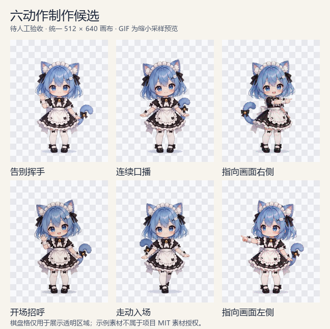

# Sprint Motion Studio · 素材创意工坊

基于 [FrameBaker](https://github.com/taotao7/FrameBaker) 二次开发的 Windows 动画素材工具。现在的界面采用糖果配色与手绘边框，支持视频完整抽帧、抠图修正、地面基准对齐、审核导出，以及共享工作区的 CLI / MCP。

**[下载 Windows 便携安装包](https://github.com/wzh20010805-boop/Sprint-Motion-Studio/releases/latest)** · [使用说明](docs/p3-p5-guide.md) · [开发与验证记录](docs/evidence/p2-p5/report.md) · [二次开发说明](README_SFS.md)

**版本范围：已发布便携版为 1.0.7 / 生产 API 1.1；当前源码为生产 API 1.3。** 下文的协作任务、固定候选与独立验收是源码新增功能，新协作便携包的集成与验证尚未完成，当前下载包不包含这些更新。

## 界面与工作流程示例

以下为 **1.0.7 版实拍界面**，使用现有 test 项目的 14 帧动作，以及保留的原视频和完整抽帧素材。



| 主编辑器 · 左右键逐帧预览 | 素材库 · 项目 / 视频 / 照片分区 |
| --- | --- |
|  |  |

## 奔跑案例

原视频展示实际来源；下方动作预览由 test 项目最近一次正式导出的 **14 张透明 PNG** 生成。动图中的棋盘格用于展示透明区域，实际 PNG 和精灵图集保留透明通道。完整源视频的其它帧仍需单独检查。

| 导入的原视频 | 最新正式导出的 14 帧动作预览 |
| --- | --- |
|  |  |

[查看透明 PNG 示例](docs/media/sfs/v1.0.7/frame_000001.png) · [查看规则精灵图集](docs/media/sfs/v1.0.7/sprite-sheet.png)

| 遮罩修正 | 地面基准与统一画布 |
| --- | --- |
|  |  |

[下载此案例的原视频](docs/media/sfs/source-run.mp4)。展示媒体用于说明本项目工作流程；沿用用户此前提供的素材，不属于项目 MIT 源码许可授权的素材库。

## 六动作制作案例 · 待人工验收

本次沿用用户已有素材，展示告别挥手、连续口播、指向画面右侧、开场招呼、走动入场、指向画面左侧六个动作，统一画布为 **512 × 640**。这些是**制作候选展示，待人工验收**（`draft_pending_human_review`）；动图经过展示采样，不能替代全部最终帧与整体播放的人工检查。




[查看案例说明与透明 PNG](docs/media/sfs/cases-2026-10-14/README.md) · [查看案例状态与帧数](docs/media/sfs/cases-2026-10-14/case-info.json)。棋盘格仅是透明区域的展示背景；展示素材用于说明流程，不属于项目 MIT 源码许可授权的素材库。

## 可以做什么

- 导入 MP4 / GIF 或 PNG 序列，保留原文件、完整显示帧与源时序。
- 本地 CPU 自动抠图、框选角色，擦除 / 恢复遮罩，撤销并逐帧检查透明边缘。
- 主编辑器和场景抠图窗口支持键盘 ← / → 快速逐帧预览。
- 素材库按“项目 → 视频 / 照片”浏览，支持跨项目复用与原件保留；照片分区包含视频抽帧图片。
- 调整公共画布、比例、地面根点及逐帧偏移，通过预览核对动作。
- 经审核导出透明 PNG 序列、规则多页图集、manifest、联系表、背景 MP4 与完整 ZIP；未审核内容可以显式导出草稿。
- GUI、CLI 与 MCP 共用同一工作区；源码的制作工具可以创建、检查和提交候选，人工批准由桌面验收入口完成。

## 源码新增协作流程 · 生产 API 1.3

- 协作 Task 保存用户原话、经核验的来源身份和制作要求；制作草稿与不可变候选分开，候选固定最终 PNG、图集及有理数时长。
- 全帧自动技术检查与有界抽样观察保留各自证据和未观察范围；检查完成不代表人工质量验收通过。
- 独立 Canvas 验收窗口读取固定候选，可切换最终图、源图、Alpha 及棋盘格 / 黑 / 白背景。用户逐帧审核并确认整体播放；检查全部最终帧和播放后，也可明确选择“确认整个动作并允许导出”。未解决问题和需修复帧会阻止整段确认。
- 问题可关联帧和区域；重新修改保留父候选，生成新候选后显示变化及复审范围，再由人工确认。
- 人工验收后从固定候选打包透明 PNG、图集、联系表、manifest、质量报告与 ZIP；支持原操作恢复，输入变化或批准撤回会阻止无效交付，历史文件和记录保留。

CLI / MCP 的 maker 工具负责制作、检查、提交与读取交付，不提供人工批准能力。实际工具和接口见 [API 1.3 说明](docs/api.zh-CN.md#生产13制作门面与固定候选http接口)；本次源码更新及播放、对齐、抠图修复见 [Unreleased 变更日志](docs/CHANGELOG.zh-CN.md#unreleased)。

## Windows 安装与启动

1. 从 [最新 Release](https://github.com/wzh20010805-boop/Sprint-Motion-Studio/releases/latest) 下载 Windows 便携 ZIP（文件名为 `SpriteMotionStudio-win-x64-版本号.zip`）。
2. 解压到可写目录，双击 `SpriteMotionStudio.exe` 或 `START.cmd`。这是便携安装包，无需另装 Node.js、Bun 或 Python。
3. **当前便携包未内置 u2netp 模型。** 没有安装模型的电脑，首次自动抠图需在「素材工坊」菜单选择“离线导入模型”或“下载 CPU 模型（需联网）”。已安装过的模型会继续复用，无需每次导入；模型准备好后，自动抠图也可断网运行。
4. 工作区默认存入当前用户 LocalAppData 下的 `SpriteMotionStudio/workspaces/default`，可通过菜单切换到已有工作区。

模型安装在当前用户的 `%LOCALAPPDATA%\SpriteMotionStudio\models`。你本机已有模型，并不表示下载的 ZIP 内也包含模型；将便携包发到另一台电脑时，需要在那里准备模型。导入素材、修正已有遮罩、预览和导出可离线使用。

包内附 SHA256 校验清单、许可、CLI / Codex 接入说明与示例媒体。本版已完成本机 Windows 启动、换目录、受限 PATH、300 帧纹理预算及 GUI / CLI 输出一致性验证；干净 Windows 虚拟机与真实美术质量验收尚未完成。二进制未签名。

## CLI 与 Codex

以下为已发布 1.0.7 便携包的基础 CLI 示例：

```powershell
.\sfs.exe doctor --json
.\sfs.exe project list --json
.\sfs.exe --help
.\sfs.exe schema --name recipe --json
.\sfs.exe mcp --stdio --workspace "D:\素材工作区"
```

便携版参数、审核规则和 recipe 示例见 [P3–P5 使用说明](docs/p3-p5-guide.md)。当前源码使用 `sfs.cmd`，新增 Task、候选、自检、返工与原操作恢复命令，见 [API / CLI / MCP 说明](docs/api.zh-CN.md#生产13制作门面与固定候选http接口)。项目提供 [本地 Skill](skills/soldier-frame-studio/SKILL.md)，不会自动修改全局 Codex 配置。

## 从源码开发

```powershell
git clone https://github.com/wzh20010805-boop/Sprint-Motion-Studio.git
cd Sprint-Motion-Studio
powershell -NoProfile -ExecutionPolicy Bypass -File .\scripts\setup_sfs.ps1 -IncludeDesktop -IncludeValidationPython
.\sfs.cmd doctor --json
.\Start-SFS.cmd
```

源码统一通过 `Start-SFS.cmd` 启动桌面入口；CLI / MCP 使用相同 `--workspace`，从工作区发现并复用本地服务，端口通过工作区服务发现，无需填写历史端口。源码启动需要 FFmpeg / ffprobe；安装说明见 [README_SFS.md](README_SFS.md)。开发检查：`bun test tests`、`bun run typecheck`、`python -m pytest workers/image/tests`。用户工作区、模型、虚拟环境及构建输出不提交到 Git。

## 工作区与端口管理（当前源码）

源码 GUI、CLI、MCP 和 `bun run start` / `bun run dev` 使用同一工作区解析规则：显式 `--workspace` > `SFS_WORKSPACE` > 登记表的当前工作区 > 默认目录。源码登记表为仓库 `.sfs/workspaces.json`，默认目录为 `workspaces/default`；后续重建的便携版登记表位于 `%LOCALAPPDATA%\SpriteMotionStudio\workspaces.json`，默认目录位于同处 `workspaces/default`。已发布1.0.7包仍采用原来的工作区选择方式。

```powershell
.\sfs.cmd workspace list --json
.\sfs.cmd workspace add --name character --directory "D:\素材工作区"
.\sfs.cmd workspace use --name character
.\sfs.cmd workspace current --json
.\sfs.cmd service status --json
# 保存并关闭 GUI/MCP，确认任务完成后停止当前工作区服务：
.\sfs.cmd service stop --json
.\sfs.cmd service clean --json
```

`add` 只登记已有目录；`use` 也可用 `--directory` 选择已有目录，不搬移或合并数据库。每个活动工作区仅开一个动态分配的 `127.0.0.1` HTTP端口，网页、API、WebSocket、制作MCP共用；历史端口不是新的服务。`list` / `status` 不启动服务、不显示令牌，只有核实当前实例后才显示端口。桌面人工审核管道保留独立权限边界，不是重复HTTP接口。

`stop` 向已核实服务请求协作退出；存在任务、其他请求或WebSocket连接时拒绝，不按历史PID强制杀进程。`clean` 只清理已证明所有者退出的匹配发现记录及旧 `before-human-desktop` 备份；活动、损坏或归属不明记录保留待核查。原始素材、固定候选、审核记录、数据库和日志不会被这些命令删除。详细契约见 [API 1.3说明](docs/api.zh-CN.md#工作区与服务管理api13)。 本次本机重复文件清理、工作区登记与保留项见[瘦身与工作区审计记录](docs/workspace-cleanup-2026-10-14.md)。

## 来源与许可

保留 [FrameBaker](https://github.com/taotao7/FrameBaker) 的上游历史与 [MIT 许可](LICENSE)。Windows 包中的运行时、FFmpeg、字体和 Python 依赖各自遵循其许可证，详见 [第三方说明](THIRD_PARTY_NOTICES.md) 和 [依赖源码与重建说明](docs/licenses/distribution-sources.md)。上游界面和演示案例已由本项目实拍界面与用户此前提供的奔跑案例替换。

## 最近版本

<!-- latest-changelog:start -->
## Latest Changes

### [1.0.7](docs/CHANGELOG.md#107---2026-10-12) · 2026-10-12

- Add left/right keyboard navigation to the main frame editor so the current animation axis can be inspected step by step without clicking each timeline cell. Preserve input, dialog and canvas interaction shortcuts.

### [1.0.6](docs/CHANGELOG.md#106---2026-10-12) · 2026-10-12

- Correct cyan button glow: glow only on hover, restore the sticker shadow on pointer leave, and retain keyboard focus outlines.
- Add left/right keyboard frame navigation to the cutout workshop, with stale image response protection, unsaved stroke confirmation, and input/drawing guards.
- Group the material library by project, then videos/photos. Uploads can select a project; proven legacy associations, shared materials, custom folders and original files are preserved.

[View the complete changelog →](docs/CHANGELOG.md)
<!-- latest-changelog:end -->
