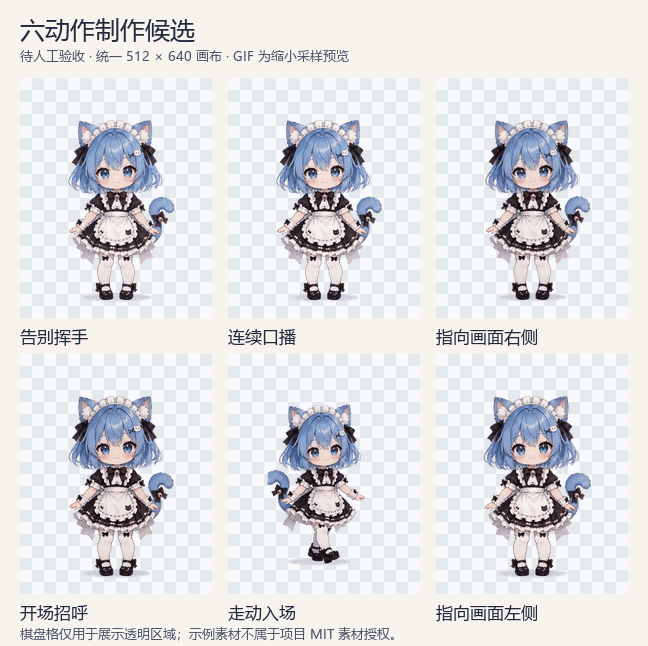

# 素材创意工坊：源码协作流程 / Windows 便携版

**本次 Windows 便携版为 1.0.8 / 生产 API 1.3，与当前源码功能一致。** 从 [最新 Release](https://github.com/wzh20010805-boop/Sprint-Motion-Studio/releases/latest) 下载并完整解压，双击 `SpriteMotionStudio.exe` 或 `START.cmd`，无需启动 bun dev。便携版包含遮罩修正、地面轨迹/公共比例/画布、透明序列/图集/ZIP、任务恢复、CLI/MCP，以及协作 Task、固定候选、独立人工验收和统一工作区管理。旧 1.0.7 / API 1.1 仍保留在历史 Release。

便携版说明见 [使用与Codex接入](docs/p3-p5-guide.md)；[实施验证报告](docs/evidence/p2-p5/report.md)保留最初 P2–P5 阶段的历史验证记录，不能直接替代 1.0.8 发行包验证。当前接口见 [API 1.3](docs/api.zh-CN.md#生产13制作门面与固定候选http接口)，本版变更见 [1.0.8 变更日志](docs/CHANGELOG.zh-CN.md#108---2026-10-15)；包的验证结果以本次 Release 说明为准。真实动作人工质量确认、干净 Windows 虚拟机验收仍待完成；P6不在本次范围。

基于 FrameBaker 原有 React / Pixi、Bun / Elysia / SQLite 开发，保留完整上游 Git 历史。当前可以创建项目、导入视频、完整抽帧和场景抠图修正；GUI 与 CLI 共用一个后端和数据库。

**原始素材独立保留；工作台另行生成透明 RGBA。** 当前便携包未内置CPU模型。在没有模型的电脑上，首次自动抠图需通过「素材工坊」菜单离线导入或明确下载 u2netp；模型保存在 `%LOCALAPPDATA%\SpriteMotionStudio\models`，以后会继续复用，准备好后自动抠图可断网运行，无需CUDA。本机已安装的模型不会自动打入发行ZIP。既有非协作动作正式输出要求当前遮罩与地面轨迹审核；协作动作要求最终候选逐帧与整体播放的人工验收，内容变化后按影响重新确认。没有修改现有游戏或个人知识库。

## 制作 → 候选 → 人工验收 → 固定交付

- 协作 Task 固定用户原话、服务核验的来源身份和制作要求；草稿可继续修改，不可变候选保存最终 PNG、图集、有理数时长及来源记录。
- 制作侧执行全帧技术检查和有界抽样观察，保留未观察帧及不确定性；自动检查和 maker 自检均不授予人工批准。
- 独立 Canvas 验收读取冻结像素，可对照源图、Alpha、父候选和变化范围，记录逐帧判定、区域问题及整体播放确认。用户检查全部最终帧和播放后，可以明确选择“确认整个动作并允许导出”；未解决问题和需修复帧仍阻止确认。
- 重新修改保留旧候选及问题记录，返回制作副本，提交新候选后再人工验收。正式交付复制已接受候选的固定字节，包含透明序列、图集、联系表、manifest、质量报告与 ZIP；支持抽帧、候选构建和交付的原操作恢复，历史尝试和文件保留。

CLI / MCP 的 maker 工具仅负责制作、检查、提交与读取交付；人工批准来自当前桌面审核会话。实际工具由 `inspect_capabilities` 返回，完整契约见 [API / CLI / MCP 说明](docs/api.zh-CN.md#生产13制作门面与固定候选http接口)。

### 六动作案例：制作候选展示，待人工验收

沿用用户已有素材，六动作依次为告别挥手、连续口播、指向画面右侧、开场招呼、走动入场、指向画面左侧，统一 **512 × 640** 画布；状态均为 `draft_pending_human_review`。



[查看代表帧联系表](docs/media/sfs/cases-2026-10-14/actions-contact-sheet.png) · [案例说明与透明 PNG](docs/media/sfs/cases-2026-10-14/README.md)。动图经过展示采样，不能代替全部最终帧与整体播放的人工检查。展示素材用于说明流程，不属于项目 MIT 源码许可授权的素材库；此前公开的 [奔跑案例](README.zh-CN.md#奔跑案例)继续保留。

## 本机运行

在 Windows 资源管理器打开本仓库目录，双击 `Start-SFS.cmd`。窗口标题为“素材创意工坊 · Sprite Motion Studio”。源码版采用下文的统一登记与选择规则，未指定时默认使用本仓库的 `workspaces/default`。1.0.8 便携版采用相同选择规则，默认使用当前用户的 `LocalAppData/SpriteMotionStudio/workspaces/default`，可通过“切换工作区”或 CLI 选择已有项目目录。

在本仓库打开 PowerShell：

```powershell
.\sfs.cmd doctor --json
.\Start-SFS.cmd
```

`Start-SFS.cmd` 使用已经安装的 Electron 开发宿主，进入现有素材库。CLI / MCP 传入相同 `--workspace`，从该工作区发现并复用本地服务，端口通过工作区服务发现，无需填写历史端口；生产 API 版本不兼容时明确拒绝连接。新建项目后，在项目编辑器的“导入 → 上传文件”选择 MP4；默认“全部原始帧”。旧 FPS 采样是显式选项，会主动跳帧。导入后点击“场景抠图与修正”处理前景。

### 只预览指定帧

主编辑器播放控制条的 FPS 范围为1–120，48/60/120可加快浏览原24fps序列；每个步骤若含多个tick，按步骤时长停留。提高播放FPS不会生成中间帧。候选验收使用冻结候选的原始有理数时长，独立于主编辑器FPS。源码改动需重启本地服务与窗口后加载。

主编辑器和场景抠图窗口支持键盘 ← / → 快速逐帧预览；输入框、弹窗、绘画和拖放期间保留原有按键行为。

在项目中点击“播放预览”，在画布下方的播放控制条将“全部帧”改为“指定范围”，填写“起始帧”和“结束帧”，按 Enter 或移开输入焦点应用。例如 10–30 会循环播放时间轴第10至第30帧（包含两端）；两项都填10则只显示第10帧。范围内仍按已有帧时长和 FPS 播放，也可暂停后填写。

改回“全部帧”恢复完整预览。范围只在当前编辑会话中生效，不修改素材、时间轴或导出范围；切换动作重置，删帧后自动限于剩余帧。应用更新后需重启工具和其本地服务，以加载新的前端资源。

首次准备 / 重建依赖：

```powershell
powershell -NoProfile -ExecutionPolicy Bypass -File .\scripts\setup_sfs.ps1 -IncludeDesktop -IncludeValidationPython
```

该脚本仅使用本工作区的 `.runtime`、仓库依赖和 `.venv-image`；固定 Bun 1.4.2，按锁文件安装 JS 依赖，Python 验证依赖仅 Pillow / pytest。FFmpeg 和 ffprobe 使用现有 PATH，不自动安装 GPU 栈或模型。Electron 是开发宿主，首次获取需要网络。

## 工作区与端口管理

1.0.8 便携版与源码 GUI、CLI、MCP 使用同一工作区解析规则：显式 `--workspace` > `SFS_WORKSPACE` > 登记表的当前工作区 > 默认目录。源码登记表为仓库 `.sfs/workspaces.json`，默认目录为 `workspaces/default`；便携版登记表位于 `%LOCALAPPDATA%\SpriteMotionStudio\workspaces.json`，默认目录位于同处 `workspaces/default`。`bun run start` / `bun run dev` 也遵循同一规则；以下源码命令在便携目录中将 `sfs.cmd` 换为 `sfs.exe`。

```powershell
.\sfs.cmd workspace list --json
.\sfs.cmd workspace add --name character --directory "D:\素材工作区"
.\sfs.cmd workspace use --name character
.\sfs.cmd workspace current --json
.\sfs.cmd service status --json
# 保存并关闭 GUI/MCP，确认任务完成后停止当前工作区服务：
.\sfs.cmd service stop --json
.\sfs.cmd service clean --json
```

`add` 只登记已有目录；`use` 也可用 `--directory` 选择已有目录，不搬移或合并数据库。每个活动工作区仅开一个动态分配的 `127.0.0.1` HTTP端口，网页、API、WebSocket、制作MCP共用；历史端口不是新的服务。`list` / `status` 不启动服务、不显示令牌，只有核实当前实例后才显示端口。桌面人工审核管道保留独立权限边界，不是重复HTTP接口。

`stop` 向已核实服务请求协作退出；存在任务、其他请求或WebSocket连接时拒绝，不按历史PID强制杀进程。`clean` 只清理已证明所有者退出的匹配发现记录及旧 `before-human-desktop` 备份；活动、损坏或归属不明记录保留待核查。原始素材、固定候选、审核记录、数据库和日志不会被这些命令删除。详细契约见 [API 1.3说明](docs/api.zh-CN.md#工作区与服务管理api13)。 本次本机重复文件清理、工作区登记与保留项见[瘦身与工作区审计记录](docs/workspace-cleanup-2026-10-14.md)。

## 不开 GUI 的最小流程

以下为基础导入与抽帧流程。协作 Task、候选和返工命令见 [API / CLI / MCP 说明](docs/api.zh-CN.md#生产13制作门面与固定候选http接口)；人工验收仍需桌面入口。

```powershell
$ws = Join-Path $PWD 'workspaces\my-soldier'
$created = .\sfs.cmd project create --workspace $ws --name '小兵' --json | ConvertFrom-Json
$pidSfs = $created.data.project.id
$imported = .\sfs.cmd import video --workspace $ws --project $pidSfs --file 'D:\素材\attack.mp4' --json | ConvertFrom-Json
$clip = .\sfs.cmd clip create --workspace $ws --project $pidSfs --source $imported.data.source_id --name attack --json | ConvertFrom-Json
.\sfs.cmd extract --workspace $ws --project $pidSfs --clip $clip.data.clip_id --mode all --wait --json
.\sfs.cmd project inspect --workspace $ws --project $pidSfs --json
.\sfs.cmd gui --workspace $ws
```

示例视频路径需替换为自己的素材。JSON 的 ID 均来自真实响应。一次命令只向 stdout 输出一个 JSON，后台日志写工作区 `.sfs/service.log`。不加 `--wait` 会快速返回真实 `job_id`；随后可运行 `job status --job ID`、`job wait --job ID`、`job cancel --job ID`。每个业务命令都可附带 `--workspace`；未指定时按环境变量、当前登记、默认目录依次选择。

退出码：0 请求接受 / 等待成功；1 未分类执行错误或等待超时；2 参数 / 输入错误；3 依赖 / 后端缺失；4 待人工处理；5 等待任务取消；6 修订 / 工作区 / 旧结果冲突。`job status` 查询历史失败任务仍返回0，`job wait` 则返回该任务对应失败码。超时不会取消后台任务。

## 数据和生命周期

```text
workspaces/<name>/
  framebaker.db                 # 唯一数据库；当前源码 schema 5 增量迁移
  workspace.json               # 工作区标识
  backups/                     # 迁移前 SQLite 一致快照，包括 WAL
  sources/<source-id>/
    original.mp4               # 内容识别后复制一次，也可能 original.webm/bin
    source.json                # 原始名称、SHA256、探测结果
    raw/frame_000000.png        # 完整源帧，零起始整数索引
    timing.json                # 整数 PTS、time_base、有理数显示时长
    staging-*/                 # 失败/取消中间结果仍保留
  projects/<project-id>/raw/    # GUI 可编辑副本，独立于 sources/raw
  jobs/<job-id>/job.log
  .sfs/service.json            # 本地服务发现；含私密令牌，不提交/分享
```

抽帧不用采样 FPS、数量上限或去重。读取全部显示帧，按源整数索引排序；保留重复画面。数量、尺寸、所有 PNG 完整解码通过后才发布 raw 和 timing，错误不会提交完成的项目帧。复用缓存时也重新验证时间清单和 PNG。VFR 源时序精确保存；现有上游整数 tick 时间轴预览可能量化，输出 `PREVIEW_TIMING_QUANTIZED`，不能把预览当作精确源时长。

服务在加载数据库前取得工作区实例锁，只绑定 `127.0.0.1`。CLI 复用已存在的服务；Electron 通过 HttpOnly 本地 cookie 接入同一服务。API / WS 检查令牌、Host 和 Origin。无任务、无客户且闲置5分钟后服务退出；关 GUI 不会杀死共享服务或 CLI 任务。重启保留任务参数，并把未完成任务标记为 `interrupted`；通过 `job status` 查看状态，对支持恢复的流水线任务使用 `job resume --job ID --wait`，也可重新提交保留原件的抽帧任务。

遇到 `service.recovery` 残留时先核查记录 PID 和 `.sfs/service.log`，确认没有该工作区服务后再人工处理；程序保守拒绝猜测性删除。原始文件、失败目录和日志均保留。GUI 删除/裁切只影响独立可编辑副本。首次仅使用短视频；磁盘预检查基于解码尺寸和实际探测帧数。

目前只接受可可靠处理的 SDR、逐行、方形像素、无旋转视频。HDR、交错、显示矩阵异常、缺失/非单调 PTS、损坏或无视频流明确失败。末帧没有可信时长时会估算并输出警告；唯一帧没有可信时长则失败。

## 历史验证与当前限制

- [环境与版本](docs/environment.md)、[上游审计](docs/upstream-audit.md)、[第三方许可](THIRD_PARTY_NOTICES.md)。
- [P0 桌面探针](docs/desktop-probe.md)：已验证固定 Bun + Electron 路径；完整 Bun 单 EXE 失败，失败证据保留。探针包有依赖开发目录的 junction，尚不能作为干净机器发行包。
- [P1 全帧报告](docs/evidence/p1/extraction-report.md)、[真实 PNG 检查](docs/evidence/p1/quality-report.md)、[开发进度与交接](docs/progress.md)。
- [P1 桌面验证](docs/p1-desktop.md)记录真实 GUI、同一项目 CLI 读回和截图。

上述 P0/P1 报告使用本机 FFmpeg 生成的合成视频。真实 PNG 已逐个解码并打开 contact sheet，但无法替代带场景小兵视频的武器、头发和装备抠图验收。历史 P0 已实证上游无引擎时复制原图却标记 matted，P1 隔离入口明确阻止这类自动抠图请求。当前 `bun run start` 和 `bun run dev` 已统一进入 `runtimeBootstrap.ts`，取得工作区锁、初始化鉴权与审核管道、恢复协调后才监听；默认 `PORT=0`。桌面使用 `sfs.cmd gui` / `Start-SFS.cmd`，MCP使用stdio桥。

项目导入与素材库上传都会独立保留图片、视频/GIF原件及完整抽帧图片，可跨项目重复使用；升级首次启动会补登记旧项目资料。素材库视频改为完整抽帧，不提供旧FPS/定点采样。抠图请导入项目后使用「场景抠图与修正」。云生成、提示词加强、外部 provider 测试和宽权限上游 MCP 在该入口禁用。设置页沿用上游页面，但不代表这些能力已开放。

开发验证（Bun 路径需按当前目录调整）：

```powershell
$env:PATH = (Resolve-Path '..\.runtime\node_modules\@oven\bun-windows-x64\bin').Path + ';' + $env:PATH
bun run typecheck
bun run test
bun run build:cli
.\dist\sfs.exe doctor --json
```

运行 `build:cli` 后生成的 `dist/sfs.exe` 仍需要邻接仓库源码和固定 Bun（也可设置 `SFS_REPO_ROOT`），不同于 Release 中附带完整运行时的独立便携包。源码按需重建 CLI；完整便携构建使用 `scripts/build_portable.ts` 并在新目录验证，禁止覆盖既有发行目录。FFmpeg GPL 构建的再分发责任、模型权重许可和正式离线资源完整性见 [分发源码与重建说明](docs/licenses/distribution-sources.md)。
